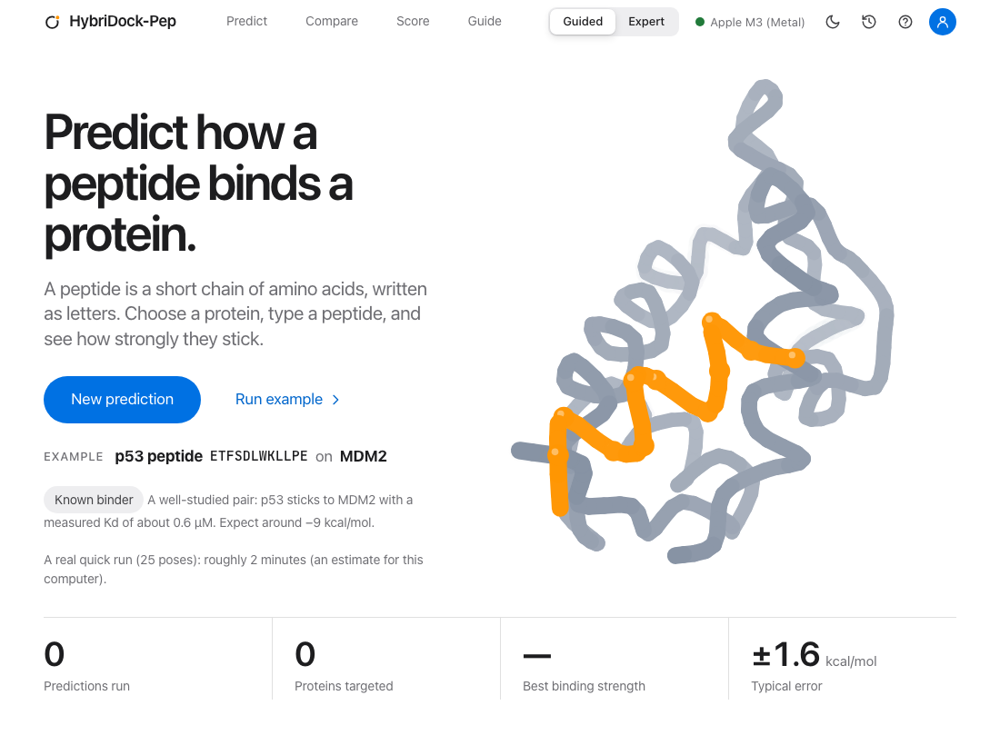
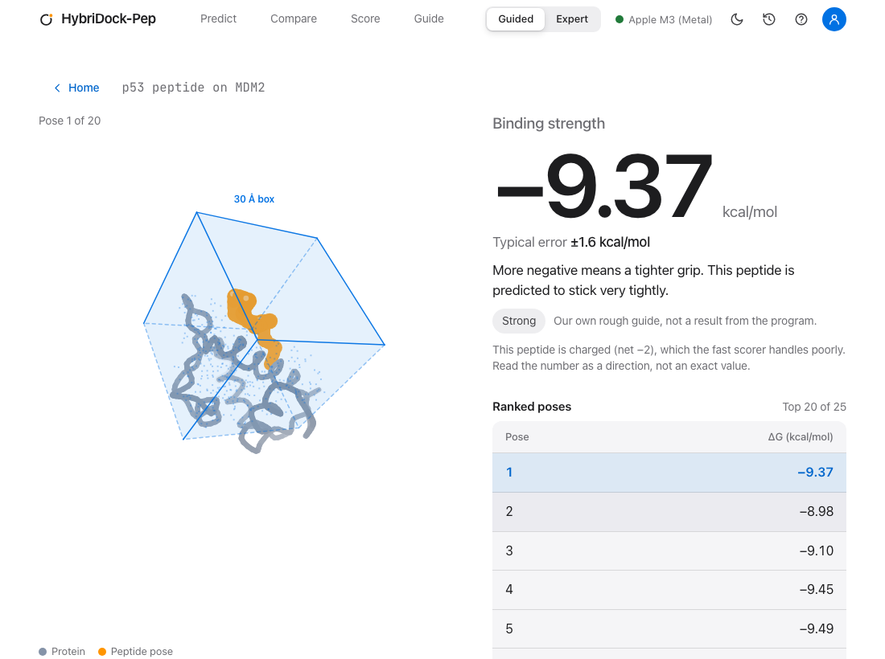

# HybriDock-Pep guide

HybriDock-Pep predicts how tightly a short chain of amino acids (a peptide) sticks to a protein, and shows where it sits.
The same short lessons are built into the app: open **Guide** in the top bar.

## Get the app

```bash
git clone --recurse-submodules https://github.com/Tasty-Ramen2010/hybridock-pep.git
cd hybridock-pep
./install.sh
```

The install takes about 30 minutes, once. Start the app again any time with `./launch_web.sh`. On Windows, double-click
`install.bat`, then `launch_web.bat`. The first prediction downloads about 2.5 GB of model files (around 10 extra minutes, once).

## Your first prediction



1. On Home, press **Run example** for a finished result in one click, or press **Predict** to use your own.
2. **Choose a protein.** Pick one from the list, type a four-letter PDB code, or upload a `.pdb` file.
3. **Type a peptide**, 3 to 30 letters.
4. **Mark the binding site.** Press **Use the suggested site**, or drag the box over the part you care about.
5. **Choose how thorough**: **Quick** for a first look, **Full** for the most reliable result. Press **Run prediction**.

You can leave the page while it runs. **Run in progress** in the top bar brings you back.

## Read your result



The big number is **ΔG**, how tightly the peptide sticks. **More negative means tighter.** One number is off by about
±1.6 kcal/mol, so treat it as a good estimate and not a measurement. The **Strong / Moderate / Weak** label is our own rough
wording, not something the program measures. Click a row in the pose table to see that pose in 3D. **Best pose** and
**Ranked list** download your files.

## Compare two proteins

Choose a peptide, a target protein and an off-target look-alike, then press **Compare**. A ΔΔG below zero means the peptide
prefers the target. If the band around it crosses zero, there is no clear preference. Repeat important comparisons.

## Score a structure

Add a protein `.pdb` and the peptide in its bound position, check the sequence, and press **Score it**. You get a ΔG in a
few seconds, and nothing is moved.

## If something goes wrong

* **Another run is already going.** The app does one prediction at a time. Wait, or stop it from **Run in progress**.
* **No pose fit at this site.** Move the box to a more open spot, make it bigger, or try a shorter peptide.
* **Out of memory.** Close other programs, choose **Quick**, or use a shorter peptide.
* **`command not found: hybridock-pep`.** Start the app with `./launch_web.sh` from the app folder.
* **Couldn't reach the server.** Start it again with `./launch_web.sh`, reload, and press **Check again**.
